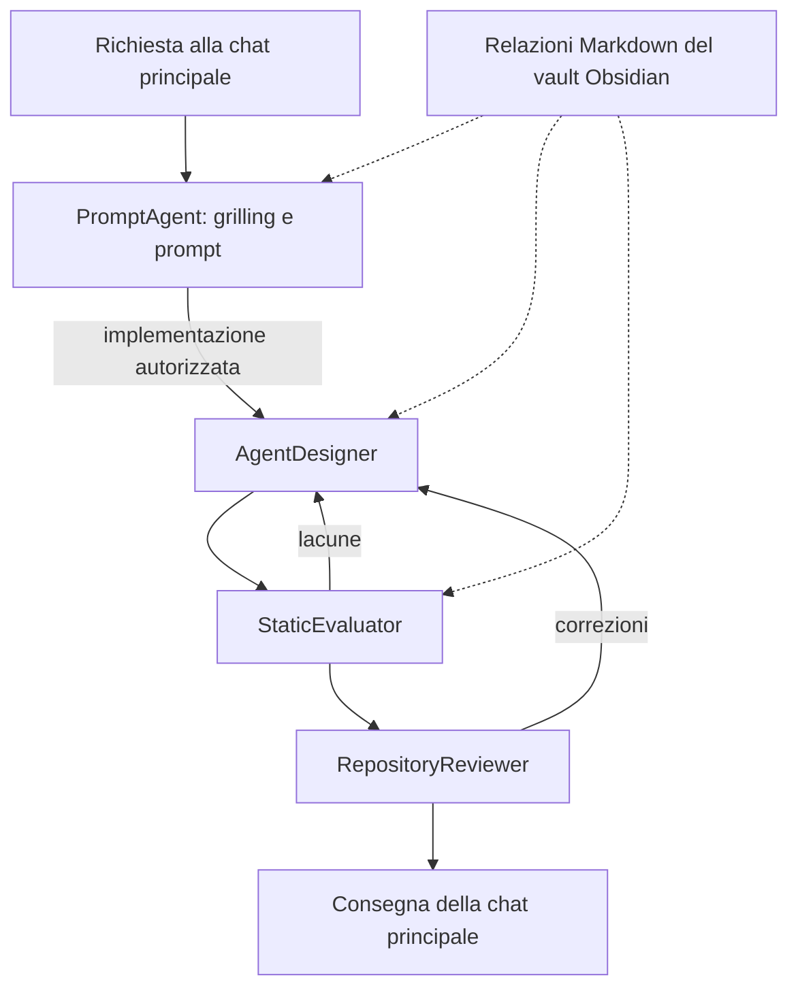

# Laboratorio locale PROMPT_AGENTI

Questa cartella contiene gli strumenti per creare e migliorare i prodotti di questo repository. Gli agenti esportabili restano in `Agents/`, le skills esportabili in `Skills/`. Nessun pack dipende da questo laboratorio.

## Agenti operativi

| Configurazione | Ruolo | Permessi |
|---|---|---|
| [PromptAgent](agents/prompt-agent.toml) | Chiarisce con grilling, consulta il grafo, prepara prompt mirati. | Sola lettura |
| [AgentDesigner](agents/agent-designer.toml) | Crea e migliora agenti, skills e documentazione autorizzati. | Scrittura nel workspace |
| [StaticEvaluator](agents/static-evaluator.toml) | Controlla istruzioni, responsabilità, contratti e collaborazione. | Sola lettura |
| [RepositoryReviewer](agents/repository-reviewer.toml) | Controlla modifiche e separazione finale. | Sola lettura |

La chat principale conserva richiesta e decisioni, coordina i passaggi e salva i report ricevuti dai ruoli in sola lettura. Il precedente RepositoryMaintainer è sostituito da queste responsabilità distinte.

## Skills locali

- [prompt-repository-maintenance](skills/prompt-repository-maintenance/SKILL.md): procedura comune e separazione dei prodotti.
- [grilling](skills/grilling/SKILL.md): domande mirate sulle decisioni aperte; PRD solo quando richiesto.
- [agent-design](skills/agent-design/SKILL.md): costruzione e revisione di ruoli e procedure.
- [scope-and-handoff](skills/scope-and-handoff/SKILL.md): requisiti, responsabilità e consegne.
- [agent-graph-analysis](skills/agent-graph-analysis/SKILL.md): relazioni dei Markdown verificate nelle istruzioni.
- [static-agent-evaluation](skills/static-agent-evaluation/SKILL.md): casi e rubric per valutare le specifiche.
- [export-pack-validation](skills/export-pack-validation/SKILL.md): indipendenza e integrità delle copie.

Sono procedure locali autonome, anche quando adattate da una skill generale. Le modifiche non si propagano fra le due aree.

## Collaborazione

Si attivano solo i ruoli pertinenti. Una richiesta di solo prompt termina con PromptAgent. Ogni consegna mantiene requisiti, criteri, file, decisioni ed evidenze. Il grafo deriva dai collegamenti dei Markdown; le impostazioni `.obsidian/graph.json` non sono un elenco degli archi. Le configurazioni TOML non sono automaticamente note Obsidian.

## Configurazione e uso

[config.toml](config.toml) abilita i sottoagenti; i quattro TOML standalone dichiarano i ruoli `lab_*`. Modello e ragionamento ereditano la sessione. [AGENTS.md](../AGENTS.md) guida il coordinatore e richiede la lettura esplicita delle skills locali pertinenti.

Codex documenta la scoperta automatica delle skills di repository in `.agents/skills/`. Qui le skills restano in `.codex/skills/` per mantenere tutto il laboratorio insieme: vengono lette tramite istruzioni esplicite, senza presumere registrazione automatica o comandi dedicati.

Apri una nuova sessione per caricare le configurazioni appena aggiunte. La validità dei file è controllabile staticamente; il caricamento effettivo dei nuovi ruoli nella sessione resta da verificare.

Incolla [PROMPTME.md](PROMPTME.md) e aggiungi la richiesta concreta. I report locali nuovi vanno in `.codex/reports/`; i report già presenti in `Agents/` restano documenti storici e possono citare percorsi precedenti.

La valutazione locale è esclusivamente statica: nessuna misura inventata di qualità operativa, token, costi o latenza.

Riferimenti di configurazione: [sottoagenti Codex](https://learn.chatgpt.com/docs/agent-configuration/subagents), [skills Codex](https://learn.chatgpt.com/docs/build-skills).
