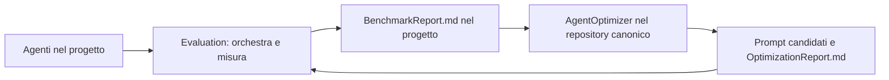

# PROMPT_AGENTI

Raccolta di istruzioni per agenti e procedure riutilizzabili, per qualsiasi linguaggio o tipo di software. Contiene nove agenti e quattordici skills esportabili. Il laboratorio locale in .codex contiene quattro agenti operativi e sette skills per creare e migliorare questi prodotti. I file esportabili sono istruzioni da fornire alla chat o all'ambiente di lavoro.

## Struttura

```text
PROMPT_AGENTI/
├── README.md
├── AGENTS.md   # istruzioni del coordinatore locale
├── .codex/     # laboratorio locale: agents/, skills/, configurazione e prompt
├── Agents/     # un file per agente
├── Skills/ # tutte le skills: nome-skill/SKILL.md e risorse pertinenti
├── Prompts/    # prompt da incollare, per attività distinte
└── Starter_pack/ # quattro pacchetti esportabili con PROMPTME.md
```

`Skills/` è la raccolta unica: contiene le quattro skills del progetto e le dieci scaricate da Matt Pocock e Caveman. Le provenienze e le dipendenze sono documentate nel catalogo delle skills.

## Quale prompt usare

| File | Uso |
|---|---|
| [CreaAppDaZero.md](Prompts/CreaAppDaZero.md) | Dall'idea a una nuova app: configura i ruoli pertinenti e prepara la base iniziale. |
| [RiorganizzaAppEsistente.md](Prompts/RiorganizzaAppEsistente.md) | Analizza e riordina un progetto già creato, proteggendo l'eventuale istanza in uso. |
| [CoverLetter.md](Prompts/CoverLetter.md) | Chiede CV, priorità, paragrafi e 2–3 lettere di esempio; genera le istruzioni personalizzate per le candidature. |
| [ValutaEMiglioraAgenti.md](Prompts/ValutaEMiglioraAgenti.md) | Due attivazioni: benchmark nel progetto e revisione dei prompt nel repository canonico. |
| [Laboratorio locale](.codex/PROMPTME.md) | Chiarisce, progetta e valuta agenti e skills di questa raccolta entro uno scope esplicito. |

Per i primi due rendi accessibile l’intero App_starter_pack, incluso pack.json, agenti, skills e risorse: il PROMPTME prepara i tre ambienti con il generatore e poi avvia il task. In una chat senza filesystem puoi preparare i contenuti, ma non dichiarare installazione o riconoscimento. Un percorso locale da solo non fornisce i file a un’altra chat.

Per la cover letter incolla soltanto il suo prompt e fornisci i documenti che richiede. Il limite inferiore a 8.000 caratteri, con tetto operativo di 7.500 e conteggio automatico, riguarda le istruzioni finali personalizzate, non il prompt iniziale.

## Agenti

| File | Responsabilità |
|---|---|
| [AppStarter](Agents/AppStarterAgent_General.md) | Imposta una nuova app oppure mappa e organizza un progetto esistente. |
| [Architect](Agents/ArchitectAgent_General.md) | Decide struttura, confini e contratti trasversali in sola lettura. |
| [Backend](Agents/BackendAgent_General.md) | Codice server, logica applicativa, dati e integrazioni. |
| [Frontend](Agents/FrontendAgent_General.md) | Interfaccia e consumo delle API nelle aree compatibili con la sua specifica. |
| [AIEngineer](Agents/AIEngineerAgent_General.md) | Comportamento AI, prompt operativi, estrazione e retrieval. |
| [Reviewer](Agents/ReviewerAgent_General.md) | Controllo finale dei file modificati, in sola lettura. |
| [PromptAgent](Agents/PromptAgent_General.md) | Crea o migliora prompt su richiesta. |
| [Evaluation](Agents/EvaluationAgent_General.md) | Nel progetto: orchestra le prove degli agenti presenti, misura pipeline e handoff, salva BenchmarkReport.md. |
| [AgentOptimizer](Agents/AgentOptimizerAgent_General.md) | Qui nel repository canonico: usa i report dei progetti, revisiona i prompt e salva OptimizationReport.md. |

PromptAgent, Evaluation e AgentOptimizer si attivano per i rispettivi compiti; non sono allegati obbligatori dei prompt di sviluppo. Sono prodotti esportabili distinti dai quattro ruoli di lavoro locali. Evaluation riusa il ruolo già esistente: il sistema di valutazione ha due responsabilità distinte.

## Come collaborano

La chat principale conserva richiesta, scope, fonti autorizzate e un `TaskState` breve: requisiti `R1…`, criteri, responsabili, dipendenze, stato ed evidenze. Chi riceve il lavoro legge il codice pertinente e conserva anche requisiti bloccati o non completati, con motivo.

- **Nuovo progetto:** AppStarter imposta la base; Architect interviene per decisioni trasversali; lavorano soltanto i responsabili delle aree necessarie.
- **Progetto esistente:** un bug o una funzionalità va al responsabile dell'area. Per riordinare, AppStarter ricostruisce ingressi, moduli, dipendenze, risultati e controlli; Architect decide eventuali cambiamenti dei confini.
- **Interfacce condivise:** Backend e Frontend concordano i contratti quando collegati. AIEngineer collabora con Backend quando una parte AI attraversa il gateway server. Un file ha un solo owner; si parallelizza dopo aver fissato confini e dipendenze.
- **Consegna:** ogni responsabile passa ID dei requisiti, decisioni, file, verifiche, limiti e prossimo destinatario. Reviewer conclude i lavori che modificano file; i rilievi tornano all'owner per una correzione mirata e un nuovo controllo.

AppStarter distingue `NEW`, `EXISTING` e `RUNNING`. Per un'app in uso o dallo stato sconosciuto, il riordino avviene in una copia separata, con baseline, piccoli blocchi reversibili e controlli prima/dopo. Sostituzione della versione attiva e riavvio sono azioni distinte. Il funzionamento dichiarato deve corrispondere alle prove svolte.

Si identifica prima il tipo di software e lo stack reale. Server, UI e AI non sono obbligatori; le aree non coperte dai ruoli forniti restano alla chat principale o a un responsabile già autorizzato. La struttura segue le convenzioni del progetto, senza un framework predefinito.

## Dal progetto al miglioramento degli agenti



1. **Nel progetto:** rendi accessibile Evaluation_pack e segui la fase 1 di PROMPTME: installa Evaluation e le 14 skills complete, verifica il riconoscimento, poi avvia il benchmark. L'agente identifica i ruoli realmente presenti, prepara casi e controlli, esegue le prove consentite e salva il report in `agent-kit/reports/` o nella directory report già designata, fuori dalle cartelle di discovery. Non richiede i nomi dei nostri agenti né uno stack specifico.
2. **Qui:** porta il BenchmarkReport e le evidenze necessarie; incolla il prompt 2. AgentOptimizer collega i risultati alle versioni canoniche, applica le revisioni mirate richieste e salva OptimizationReport nella directory report designata: `agent-kit/reports/` per il runtime installato, oppure Agents/ per una semplice raccolta di specifiche non usata per discovery. Nel laboratorio locale i nuovi report seguono le sue istruzioni e restano separati dai prodotti. Se un report manca, può diagnosticare i contratti dalle istruzioni e preparare modifiche da validare.
3. **Di nuovo nel progetto:** esporta la candidata identificata da versione/hash e falla confrontare con la baseline sugli stessi casi. Una modifica testuale controllata resta `APPLICATO_DA_VALIDARE` finché manca una valutazione sufficiente. La raccomandazione sulla pipeline non effettua una distribuzione.

Il benchmark considera successo, groundedness, chiamate, token, costo, latenza p50/p95, affidabilità, correzioni umane e collaborazione. Confronta i casi peggiorati oltre alle medie. Un nuovo errore critico impedisce la promozione anche quando tempo e costo migliorano.

Il file va richiamato nella chat o configurato nell'ambiente: la sola copia in una cartella non attiva agenti. Un ambiente con runner e telemetria produce misure reali; l’applicazione dei ruoli nella stessa chat, solo se richiesta esplicitamente, è esplorativa e non sostituisce un benchmark bloccato; la lettura dei file è analisi statica. Token, costo, latenza ed edit non disponibili restano non misurati. In questo repository sono presenti le istruzioni, non un runner già integrato.

I report sono artefatti, esclusi dall'inventario degli agenti. Dataset e tracce si riutilizzano dove già esistono; in assenza di convenzioni, la skill prevede BenchmarkCases.jsonl e BenchmarkRuns.jsonl quando necessari. Con runtime installato report, dataset e tracce vanno in `agent-kit/reports/` o nella directory dedicata già designata, fuori da `.codex/agents/`, `.claude/agents/` e `.cursor/agents/`; in una semplice raccolta di specifiche possono restare nella cartella degli agenti se pertinente e non usata per discovery. I trasferimenti fra progetti avvengono con file o accessi autorizzati.

L'analisi iniziale della raccolta e lo stato delle modifiche sono in [OptimizationReport.md](Agents/OptimizationReport.md). Il metodo usa tracce e dataset per confronti ripetibili, come descritto nella [documentazione ufficiale OpenAI](https://developers.openai.com/api/docs/guides/agent-evals); le specifiche restano indipendenti dai suoi strumenti.

## Skills

La cartella `Skills/` contiene **14 skills esportabili**, tutte in cartelle identificate con `SKILL.md`. Il [catalogo completo](Skills/README.md) descrive utilizzo, provenienza, dipendenze ed esportazione. Le quattro procedure condivise dei nostri agenti sono:

| Skill | Procedura |
|---|---|
| [agent-configuration](Skills/agent-configuration/SKILL.md) | Crea o aggiorna le istruzioni, conservando personalizzazioni valide. |
| [requirement-traceability](Skills/requirement-traceability/SKILL.md) | Mantiene requisiti, criteri, owner ed evidenze attraverso i passaggi. |
| [project-graph-context](Skills/project-graph-context/SKILL.md) | Consulta eventuali grafi, verifica nel sorgente e continua dai file quando mancano. |
| [pipeline-benchmark](Skills/pipeline-benchmark/SKILL.md) | Casi, controlli, tracing, metriche, confronto e contratto del report tra Evaluation e AgentOptimizer. |

Le sette skills locali sono separate nel [laboratorio .codex](.codex/README.md#skills-locali) e non si esportano nei pack.

Gli agenti contengono una sezione **Skills per il task** con condizioni concrete di utilizzo. La selezione segue requisito, fase e responsabilità; si legge il relativo `SKILL.md` prima di applicarlo. La procedura comune di attivazione, handoff e provenienza dei dati è in `requirement-traceability`. La presenza nel catalogo non rende tutte le skills obbligatorie e non configura automaticamente gli agenti.

### Collegamento fra ruoli e skills

| Ruolo | Skills aggiuntive e fase |
|---|---|
| AppStarter | `grilling` per decisioni iniziali aperte; `codebase-design` per lo scaffold; `safe-refactor` per riordino; `investigate-first` per indagine; `verify-and-stop` per verifica richiesta. |
| Architect | `grilling` e `codebase-design` per decisioni e contratti; `safe-refactor` per pianificare il riordino in sola lettura. |
| Backend e Frontend | `codebase-design` per interfacce locali; `investigate-first` oppure `diagnosing-bugs` per diagnosi; `surgical-patch` per correzioni; `safe-refactor` per riordino; `verify-and-stop` per verifica richiesta. |
| AIEngineer | `writing-for-agents` per prompt; `grilling` per obiettivi aperti; progettazione, diagnosi, correzione e refactor nelle sue aree; `pipeline-benchmark` per preparare la consegna a Evaluation. |
| Reviewer | `verify-and-stop`, `codebase-design` e `writing-for-agents` per i criteri pertinenti; criteri di correzione/refactor e benchmark sulle evidenze consegnate, in sola lettura. |
| PromptAgent | `writing-for-agents` per scrivere prompt precisi; `grilling` per decisioni sostanziali aperte. |
| Evaluation | `pipeline-benchmark` per la prova; `grilling` per gates/budget mancanti; indagine e correzione soltanto della propria strumentazione; `verify-and-stop` per gli artefatti. |
| AgentOptimizer | `writing-for-agents` per revisioni; `grilling` per conflitti da decidere; `retro` su richiesta; `verify-and-stop` e `pipeline-benchmark` per controllo e prova successiva. |

I passaggi ordinari conservano ID, contratti ed evidenze nel TaskState. `handoff` prepara una consegna a una nuova sessione quando richiesta; `retro` si attiva per una retrospettiva richiesta. La diagnosi riusa le prove già raccolte e approfondisce solo il problema assegnato. Le skills mantengono limiti del ruolo, ownership, autorizzazioni e capacità effettive dell'ambiente.

### Creazione e trasformazione dei dati

AppStarter assegna collocazione e owner; Architect definisce i contratti; Backend realizza persistenza, import/export e seed; Frontend gestisce rappresentazione e mock conformi al contratto; AIEngineer gestisce estrazione, retrieval e dataset della propria area; Evaluation possiede i casi del benchmark; Reviewer controlla provenienza e criteri. Le parti compaiono solo quando pertinenti al progetto. Ogni artefatto mantiene schema, origine, trasformazioni, distinzione reale/sintetico e verifiche secondo la skill comune. Cache, fixture e dati persistenti hanno destinazioni distinguibili; casi e attese di valutazione restano separati dai dati di sviluppo.

Ogni agente ha un file canonico; ogni skill ha una cartella canonica. Per esportare una skill copia tutta la cartella, compresi riferimenti e script necessari, e le eventuali skills da cui dipende. Per il pacchetto dei nostri agenti mantieni `Agents/` e `Skills/` affiancate oppure aggiorna i percorsi nella copia esportata. Il generatore di agent-configuration prepara gli adattamenti Codex, Claude Code e Cursor nei progetti di destinazione, con riferimenti locali indipendenti dal pack sorgente.

## Laboratorio locale per creare agenti e skills

I quattro ruoli operativi sono in [.codex/agents](.codex/README.md): PromptAgent prepara la richiesta con grilling e analisi del grafo; AgentDesigner crea o migliora i prodotti autorizzati; StaticEvaluator controlla istruzioni e collaborazione; RepositoryReviewer revisiona le modifiche in sola lettura. La chat principale coordina e salva i report.

Leggi [.codex/README.md](.codex/README.md) per configurazione, skills e interconnessioni; usa [.codex/PROMPTME.md](.codex/PROMPTME.md) per avviare il lavoro. [AGENTS.md](AGENTS.md) stabilisce il routing locale. Le skills locali vengono lette esplicitamente dai file.

La valutazione del laboratorio è statica. Il workflow generale Evaluation → AgentOptimizer documentato sopra resta un prodotto esportabile distinto; non configura i ruoli di lavoro di questa raccolta. I nuovi report locali vanno in .codex/reports; quelli già in Agents restano storici e possono contenere vecchi percorsi.

Agents, Skills, Prompts e Starter_pack non dipendono dal laboratorio. Le configurazioni globali e quelle degli altri progetti non vengono modificate. Il riconoscimento dei ruoli va controllato nell’ambiente disponibile; quando necessario segui il ricaricamento documentato senza presumere l’attivazione.

Per usare le nuove condizioni di attivazione, rendi accessibile il catalogo e le skills selezionate: in un workspace può essere disponibile tutta `Skills/`, caricando soltanto i testi pertinenti. In una chat allega i testi necessari con nome e dipendenze. Una skill non fornita resta indisponibile; l'agente segnala il limite e completa le parti indipendenti.

Riferimenti generali per cambiamenti circoscritti e verificabili: [Google Engineering Practices](https://google.github.io/eng-practices/review/developer/small-cls.html) e [Martin Fowler](https://martinfowler.com/bliki/BranchByAbstraction.html).

## Starter pack pronti da copiare

La cartella [Starter_pack/](Starter_pack/README.md) contiene quattro pacchetti: Cover_letter_Pack, Full_stack_pack, App_starter_pack ed Evaluation_pack.

Ogni pack ha un **PROMPTME.md con il prompt da incollare**; il README indica cosa fornire e il risultato atteso. Per App Starter, Full Stack ed Evaluation rendi accessibile il pack completo e apri il progetto di destinazione nell'assistente. PROMPTME esegue il generatore Python 3.11+ in anteprima, applica le scritture dopo aver risolto i conflitti e controlla l'installazione. Prepara sempre Codex, Claude Code e Cursor; il programma disponibile viene verificato prima del lavoro dipendente. Cover Letter mantiene il processo ChatGPT e il blocco finale personalizzato con conteggio dei caratteri.

I pack includono gli agenti pertinenti e tutte le 14 skills con risorse, dipendenze e metadati. I testi si caricano al verificarsi dei trigger, non tutti a ogni task. La sorgente esportata è distinta dalle configurazioni installate; le personalizzazioni non si sovrascrivono automaticamente. Evaluation installa `evaluation` nell'app; `--phase optimizer` riguarda invece un repository canonico autorizzato. Nel laboratorio locale usa i ruoli di manutenzione esistenti, mantenendoli separati dai prodotti.

Full_stack_pack include 6 agenti e App_starter_pack ne include 7, entrambi con PromptAgent. Il ruolo crea o migliora il prompt della richiesta usando writing-for-agents e grilling quando necessario, poi prepara il passaggio agli specialisti. Si attiva per questo compito, senza rendere obbligatoria una fase di riscrittura del prompt per ogni attività di sviluppo.

## Revisione delle istruzioni — 11 ottobre 2026

PromptAgent ora descrive esplicitamente il passaggio da grilling al prompt finale. Un PRD viene prodotto soltanto quando richiesto e salvato dal responsabile autorizzato, mantenendo PromptAgent in sola lettura. I PROMPTME dei pack Full Stack e App Starter includono questa attivazione, senza imporla alle richieste di sviluppo già definite.

requirement-traceability chiarisce selezione dei ruoli, attivazioni e diagnosi quando mancano skills o delega. agent-configuration descrive il confronto delle copie esportate prima dell’aggiornamento. Le procedure importate mantengono scopo e attribuzioni; i richiami specifici del programma sono adattati e i pack derivano dalle fonti canoniche. Dettagli e limiti nel report [OptimizationReport.md](Agents/OptimizationReport.md).

## Installazione runtime nei progetti software — 14 ottobre 2026

Il [generatore locale](Skills/agent-configuration/scripts/install_agent_pack.py) usa Python 3.11+ e la sola libreria standard. Ogni pack software include una copia completa. La sintassi è:

```text
python "<pack>/Skills/agent-configuration/scripts/install_agent_pack.py" --pack "<pack>" --project "<progetto>"
python "<pack>/Skills/agent-configuration/scripts/install_agent_pack.py" --pack "<pack>" --project "<progetto>" --apply
python "<pack>/Skills/agent-configuration/scripts/install_agent_pack.py" --pack "<pack>" --project "<progetto>" --check
```

Il primo comando mostra l'anteprima. Non installa Python né modifica configurazioni globali. Il generatore prepara tutti e tre gli ambienti:

| Programma | Agenti | Skills |
|---|---|---|
| Codex | `.codex/agents/<nome>.toml` | `.agents/skills/` |
| Claude Code | `.claude/agents/<nome>.md` con frontmatter | `.claude/skills/` |
| Cursor | `.cursor/agents/<nome>.md` con frontmatter | Riusa `.agents/skills/` |

`agent-kit/INSTALLATION.json` registra fonti, nomi registrati, percorsi e hash. `agent-kit/WORKFLOW.md` documenta il coordinamento; sezioni delimitate in AGENTS.md e CLAUDE.md preservano le istruzioni esistenti. I file propri rimasti invariati sono aggiornabili, quelli personalizzati producono conflitti da risolvere prima delle scritture. Le copie skills devono restare equivalenti: Cursor può leggere anche `.claude/skills/`. La configurazione installata è autonoma; --check usa il pack per confrontare anche le fonti.

Il coordinatore distingue delega al ruolo registrato, invocazione della skill e lettura di una risorsa. Usa soltanto strumenti realmente disponibili. Se un elemento necessario non compare, controlla nome, formato, percorso, permessi, versione e ricaricamento, poi riprova dopo una correzione. Il lavoro dipendente si ferma; non viene sostituito silenziosamente da un ruolo applicato nella chat. In Claude Code verifica l'accesso a Skill e non precaricare skills manuali. In Codex il ruolo eredita i permessi della sessione: sandbox_mode nel TOML non garantisce una sandbox separata. I modelli sono ereditati dall'ambiente; la preferenza Codex di PromptAgent non è trasferita ad altri provider.

Il risultato distingue **file generati**, **configurazioni controllate**, **elementi riconosciuti** e **chiamate verificate**. --check è statico e gli ambienti non disponibili restano non verificati. In questo laboratorio non si eseguono pipeline reali; la [procedura delle chiamate](Skills/agent-configuration/references/runtime-check.md) va applicata nel progetto di destinazione. Vedi [installazione](Skills/agent-configuration/references/installation.md) e [Starter_pack/README.md](Starter_pack/README.md) per conflitti, più pack, nomi e fasi di Evaluation.

Fonti ufficiali: [Codex agenti](https://developers.openai.com/codex/subagents), [Codex skills](https://developers.openai.com/codex/skills), [Claude Code agenti](https://code.claude.com/docs/en/sub-agents), [Claude Code skills](https://code.claude.com/docs/en/skills), [Cursor agenti](https://cursor.com/docs/subagents), [Cursor skills](https://cursor.com/docs/skills).

## Usare il grafo Obsidian per migliorare la collaborazione

Il grafo dei link tra le note può essere usato come punto di ingresso per analizzare agenti, skills e passaggi di lavoro. AgentOptimizer applica [project-graph-context](Skills/project-graph-context/SKILL.md) e la [procedura Obsidian](Skills/project-graph-context/references/obsidian-workflow.md): ricostruisce i collegamenti pertinenti dai Markdown, legge le condizioni e controlla destinatari, input/output, owner e dipendenze.

Il riferimento usa gli stessi link interni che alimentano il grafo Obsidian. Non richiede una lettura della finestra né presume un'API del vault. Le impostazioni in .obsidian/graph.json descrivono la vista; le relazioni provengono dai file. Nell'analisi canonica le copie Starter_pack e i report storici non diventano ulteriori agenti.

I nomi collegati nei passaggi degli agenti rendono navigabili collaborazioni già descritte: contratti tra Backend, Frontend e AIEngineer; consegna al Reviewer; AppStarter verso Architect; report e candidata tra Evaluation e AgentOptimizer. Il contesto della frase stabilisce quando si usa la relazione: una freccia non impone una catena completa a ogni richiesta.

Ogni problema deve diventare fonte → relazione/condizione → difetto → modifica mirata → caso da misurare nel report esistente. Evaluation confronta i passaggi realmente eseguiti con quelli documentati e controlla requisiti, contratti ed evidenze nelle tracce. Link e topologia da soli non misurano qualità, costi o prestazioni.

Nel laboratorio di questo repository usa lab_static_evaluator con la skill locale agent-graph-analysis; le modifiche autorizzate spettano a lab_agent_designer. La chat principale salva il report locale. Il workflow esportabile AgentOptimizer resta un prodotto distinto.
