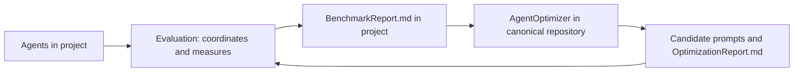

# PROMPT_AGENTI

A collection of reusable agents, skills, prompts, and starter packs for software projects. The materials in `Agents/`, `Skills/`, `Prompts/`, and `Starter_pack/` are specifications to provide to an assistant or work environment. Copying them into a folder does not automatically activate the agents. The local laboratory in `.codex/` contains four working roles and seven skills for designing and maintaining these products.

**Quick links:** [Prompts](#which-prompt-should-i-use) · [Agents](#agents) · [Skills](#skills) · [Starter packs](#ready-to-copy-starter-packs) · [Local laboratory](#local-laboratory-for-creating-agents-and-skills).

## Structure

```text
PROMPT_AGENTI/
├── README.md
├── AGENTS.md   # local coordinator instructions
├── .codex/     # local laboratory: agents/, skills/, configuration, and prompts
├── Agents/     # one file per agent
├── Skills/     # all skills: skill-name/SKILL.md and relevant resources
├── Prompts/    # prompts to paste for specific tasks
└── Starter_pack/ # five exportable packs with PROMPTME.md
```

`Skills/` is the canonical collection. It contains five project skills, five downloaded from Matt Pocock, and two from Caveman. Their origins and dependencies are documented in the skills catalog.

## Which prompt should I use?

| File | Use |
|---|---|
| [CreaAppDaZero.md](Prompts/CreaAppDaZero.md) | Go from an idea to a new app. Configure the relevant roles and prepare the initial foundation. |
| [RiorganizzaAppEsistente.md](Prompts/RiorganizzaAppEsistente.md) | Analyze and reorganize an existing project while protecting any instance currently in use. |
| [CoverLetter.md](Prompts/CoverLetter.md) | Requests a CV, priorities, paragraphs, and 2–3 sample letters, then generates customized application instructions. |
| [ValutaEMiglioraAgenti.md](Prompts/ValutaEMiglioraAgenti.md) | Two activations: benchmarking in a project and reviewing prompts in the canonical repository. |
| [Local laboratory](.codex/PROMPTME.md) | Clarifies, designs, and evaluates agents and skills in this collection within an explicit scope. |

For the first two prompts, make the entire App_starter_pack available, including pack.json, agents, skills, and resources. PROMPTME prepares the three environments with the generator, then starts the task. In a chat without filesystem access, you can prepare the content, but do not claim that anything was installed or recognized. A local path alone does not provide files to another chat.

For a cover letter, paste only its prompt and provide the requested documents. The limit below 8,000 characters, with an operational cap of 7,500 and automatic counting, applies to the final customized instructions, not the initial prompt.

## Agents

| File | Responsibility |
|---|---|
| [AppStarter](Agents/AppStarterAgent_General.md) | Sets up a new app or maps and organizes an existing project. |
| [Architect](Agents/ArchitectAgent_General.md) | Makes read-only decisions about architecture, boundaries, and cross-cutting contracts. |
| [Backend](Agents/BackendAgent_General.md) | Server code, application logic, data, and integrations. |
| [Frontend](Agents/FrontendAgent_General.md) | User interfaces and API consumption in areas covered by its specification. |
| [AIEngineer](Agents/AIEngineerAgent_General.md) | AI behavior, operational prompts, extraction, and retrieval. |
| [Reviewer](Agents/ReviewerAgent_General.md) | Read-only final review of modified files. |
| [PromptAgent](Agents/PromptAgent_General.md) | Creates or improves prompts on request. |
| [Evaluation](Agents/EvaluationAgent_General.md) | In a project, coordinates tests of the agents present, measures pipelines and handoffs, and saves BenchmarkReport.md. |
| [AgentOptimizer](Agents/AgentOptimizerAgent_General.md) | In the canonical repository, uses project reports, revises prompts, and saves OptimizationReport.md. |
| [GraphifyAgent](Agents/GraphifyAgent_General.md) | Creates or updates the code graph in `graphify-out/` on request, using code-only extraction by default. |

PromptAgent, Evaluation, AgentOptimizer, and GraphifyAgent activate for their respective tasks. They are not required attachments for development prompts. They are exportable products, separate from the four local working roles. Evaluation reuses the existing role. The evaluation system has two distinct responsibilities.

## How they collaborate

The main chat keeps the request, scope, authorized sources, and a concise `TaskState` with requirements `R1…`, criteria, owners, dependencies, status, and evidence. Requirement coverage appears once in the TaskState. Checkpoints report files, summaries, checks with commands and results, risks, blockers, and the next recipient. Blocked and incomplete requirements retain a reason.

- **New project:** AppStarter sets up the foundation. Architect handles cross-cutting decisions. Only the owners of the necessary areas work on the project.
- **Existing project:** A bug or feature goes to the owner of that area. For reorganization, AppStarter maps entry points, modules, dependencies, outcomes, and checks. Architect decides any boundary changes.
- **Code graph:** Involve GraphifyAgent only when the user asks to create or update one. The default corpus is code, results go in `graphify-out/`, and the official Graphify skill is an optional external dependency. There is no automatic installation or semantic extraction.
- **Shared interfaces:** Backend and Frontend agree on contracts when their work is connected. AIEngineer works with Backend when an AI component crosses the server gateway. Each file has one owner. Parallel work starts after boundaries and dependencies are defined.
- **Handoff and review:** The main chat starts the roles and Reviewer. It collects owner checkpoints and starts one integrated final review when needed. For a local change to a single file with no contract, security, data, or authentication impact, the short checklist is sufficient. Otherwise, review depth follows risk. Interim reviews are reserved for blockers or decisions that stop the work. After a valid finding, the owner makes a correction and the recheck covers the defect and dependent files. Do not repeat checks the Reviewer has already reported as valid.

AppStarter distinguishes `NEW`, `EXISTING`, and `RUNNING`. For an app in use or whose status is unknown, reorganization takes place in a separate copy, with a baseline and small reversible steps. Reuse valid evidence and repeat only checks invalidated by the change. Tests, typechecks, builds, linting, benchmarks, and runtime checks require relevant authorization. A generic request to verify is not sufficient. Replacing the active version and restarting it are separate actions. Claims about behavior must match the evidence collected.

First identify the software type and actual stack. A server, UI, or AI component is not mandatory. Areas not covered by the supplied roles remain with the main chat or an already authorized owner. Follow the project's conventions without defaulting to a framework.

## From project work to agent improvements



1. **In the project:** Make Evaluation_pack available and follow phase 1 in PROMPTME. Install Evaluation and the skills declared by the manifest, verify recognition, then start the benchmark. The agent identifies the roles actually present, prepares cases and checks, runs the permitted tests, and saves the report in `agent-kit/reports/` or the already designated report directory, outside discovery folders. It does not require our agent names or a specific stack.
2. **Here:** Bring the BenchmarkReport and required evidence, then paste prompt 2. AgentOptimizer connects results to canonical versions, applies requested targeted revisions, and saves OptimizationReport in the designated report directory. Use `agent-kit/reports/` for an installed runtime, or Agents/ for a simple collection of specifications that is not used for discovery. In the local laboratory, new reports follow its instructions and remain separate from the products. If a report is missing, it can diagnose contracts from the instructions and prepare changes for validation.
3. **Back in the project:** Export the candidate identified by version/hash and compare it with the baseline on the same cases. A controlled text change remains `APPLIED_AWAITING_VALIDATION` until there is sufficient evaluation. A pipeline recommendation does not deploy anything.

The benchmark considers success, groundedness, calls, tokens, cost, p50/p95 latency, reliability, human corrections, and collaboration. Compare cases that regressed as well as averages. A new critical error prevents promotion even when time and cost improve.

The file must be referenced in the chat or configured in the environment. Merely copying it into a folder does not activate agents. An environment with a runner and telemetry produces real measurements. Applying the roles in the same chat, only when explicitly requested, is exploratory and does not replace a blocked benchmark. Reading files is static analysis. Unavailable token, cost, latency, and edit data remain unmeasured. This repository contains instructions, not an integrated runner.

Reports are artifacts and are excluded from the agent inventory. Reuse datasets and traces where they already exist. If no convention exists, the skill uses BenchmarkCases.jsonl and BenchmarkRuns.jsonl when needed. With an installed runtime, put reports, datasets, and traces in `agent-kit/reports/` or the already designated directory, outside `.codex/agents/`, `.claude/agents/`, and `.cursor/agents/`. In a simple collection of specifications, they may remain in the agent folder when appropriate and when it is not used for discovery. Transfer between projects uses files or authorized access.

The initial analysis of the collection and the status of its changes are in [OptimizationReport.md](Agents/OptimizationReport.md). The method uses traces and datasets for repeatable comparisons, as described in the [official OpenAI documentation](https://developers.openai.com/api/docs/guides/agent-evals). The specifications remain independent of its tools.

## Skills

The `Skills/` folder contains **12 exportable skills**, each in a folder with a `SKILL.md` file. The [full catalog](Skills/README.md) describes their uses, origins, dependencies, and export process. The table lists the five shared project procedures.

| Skill | Procedure |
|---|---|
| [agent-configuration](Skills/agent-configuration/SKILL.md) | Creates or updates instructions while preserving valid customizations. |
| [requirement-traceability](Skills/requirement-traceability/SKILL.md) | Maintains requirements, criteria, owners, and evidence across handoffs. |
| [project-graph-context](Skills/project-graph-context/SKILL.md) | Consults available graphs, verifies against source, and continues from files when graphs are missing. |
| [pipeline-benchmark](Skills/pipeline-benchmark/SKILL.md) | Cases, checks, tracing, metrics, comparison, and the report contract between Evaluation and AgentOptimizer. |
| [folder-structure](Skills/folder-structure/SKILL.md) | Shows the current tree, finds specific files, or rereads a structure already reviewed. |

The seven local skills are separate in the [.codex laboratory](.codex/README.md#skills-locali) and are not exported in the packs.

Agents contain a **Skills for the task** section with concrete use conditions. Selection follows the requirement, phase, and responsibility. Read the relevant `SKILL.md` before applying a skill. The common activation, handoff, and data provenance procedure is in `requirement-traceability`. Presence in the catalog does not make every skill mandatory and does not configure agents automatically.

### Role-to-skill mapping

| Role | Additional skills and phase |
|---|---|
| AppStarter | `folder-structure` to locate files or map folders on request; `grilling` for open initial decisions; `codebase-design` for scaffolding; `safe-refactor` for reorganization; `investigate-first` when the cause is uncertain. |
| Architect | `folder-structure` to locate paths or reread relevant branches; `grilling` and `codebase-design` for decisions and contracts; `safe-refactor` to plan reorganization read-only. |
| Backend and Frontend | `codebase-design` for local interfaces; `investigate-first` when the cause is uncertain; minimal change for clear causes; `safe-refactor` for reorganization. |
| AIEngineer | `writing-for-agents` for prompts; `grilling` for open objectives; design, diagnosis, fixes, and refactoring in its areas; `pipeline-benchmark` to prepare a handoff to Evaluation. |
| Reviewer | `requirement-traceability`, `codebase-design`, and `writing-for-agents` for relevant criteria and evidence, read-only. |
| PromptAgent | `folder-structure` to locate files or navigate relevant folders; `writing-for-agents` to write precise prompts; `grilling` for substantial open decisions. |
| GraphifyAgent | `folder-structure` when it needs to locate the project root or paths; `project-graph-context` to consult an existing graph. To generate a graph, use a verified Graphify CLI. The official skill is an optional external dependency and is not distributed here. |
| Evaluation | `folder-structure` to locate instructions, configurations, or artifacts when needed; `pipeline-benchmark` for an explicitly requested benchmark or empirical comparison; static comparison of prompts and sources for document analysis; `grilling` when gates or budgets are missing; `investigate-first` to investigate its own instrumentation. |
| AgentOptimizer | `writing-for-agents` for revisions; `grilling` for conflicts to resolve; `retro` on request; `requirement-traceability` for document checks and `pipeline-benchmark` for subsequent evaluation. |

Routine handoffs preserve IDs, contracts, and evidence in the TaskState. `handoff` prepares a handoff to a new session when requested. `retro` runs a retrospective when requested. Start uncertain-cause investigations with `investigate-first`. Reuse evidence and investigate further only when the assigned problem requires it. Skills preserve role boundaries, ownership, authorization, and the environment's actual capabilities.

### Creating and transforming data

AppStarter assigns a location and owner. Architect defines contracts. Backend implements persistence, import/export, and seeds. Frontend handles representations and mocks that match the contract. AIEngineer handles extraction, retrieval, and datasets in its area. Evaluation owns benchmark cases. Reviewer checks provenance and criteria. Include these parts only when relevant to the project. Each artifact retains its schema, origin, transformations, real/synthetic distinction, and checks according to the shared skill. Caches, fixtures, and persistent data have distinguishable locations. Evaluation cases and expectations remain separate from development data.

Each agent has one canonical file. Each skill has one canonical folder. To export a skill, copy the entire folder, including required references and scripts, as well as any skills it depends on. For our agent pack, keep `Agents/` and `Skills/` side by side or update the paths in the exported copy. The agent-configuration generator prepares Codex, Claude Code, and Cursor adaptations in target projects, with local references independent of the source pack.

## Local laboratory for creating agents and skills

The four working roles are listed in [.codex/agents](.codex/README.md). PromptAgent prepares requests through grilling and graph analysis. AgentDesigner creates or improves authorized products. StaticEvaluator checks instructions and collaboration. RepositoryReviewer reviews changes read-only. The main chat coordinates the work and saves reports.

Read [.codex/README.md](.codex/README.md) for configuration, skills, and connections. Use [.codex/PROMPTME.md](.codex/PROMPTME.md) to start work. [AGENTS.md](AGENTS.md) defines local routing. Local skills are read explicitly from their files.

The laboratory's evaluation is static. The general Evaluation → AgentOptimizer workflow above remains a separate exportable product. It does not configure this collection's working roles. New local reports go in .codex/reports. Existing reports in Agents remain historical and may contain old paths.

Agents, Skills, Prompts, and Starter_pack do not depend on the laboratory. Global configurations and other projects are not modified. Role recognition must be checked in the available environment. When needed, follow the documented reload procedure without assuming activation.

To use the new activation conditions, make the catalog and selected skills available. In a workspace, all of `Skills/` may be available while loading only the relevant texts. In a chat, attach the required texts with their names and dependencies. If a skill is not provided, it remains unavailable. The agent reports the limitation and completes independent work.

General references for scoped, verifiable changes: [Google Engineering Practices](https://google.github.io/eng-practices/review/developer/small-cls.html) and [Martin Fowler](https://martinfowler.com/bliki/BranchByAbstraction.html).

## Ready-to-copy starter packs

The [Starter_pack/](Starter_pack/README.md) folder contains five packs:

| Pack | Purpose |
|---|---|
| [App_starter_pack](Starter_pack/App_starter_pack/README.md) | Start an app or organize an existing project. |
| [Full_stack_pack](Starter_pack/Full_stack_pack/README.md) | Develop or fix an existing project. |
| [Cover_letter_Pack](Starter_pack/Cover_letter_Pack/README.md) | Prepare customized instructions for applications and cover letters. |
| [Evaluation_pack](Starter_pack/Evaluation_pack/README.md) | Evaluate agents in a project and improve canonical prompts in a separate phase. |
| [Wiki_starter_pack](Starter_pack/Wiki_starter_pack/README.md) | Design and build a project wiki, with targeted questions, milestones, and data maintenance. |

Start Wiki Starter by pasting its PROMPTME after making the folder available in the project. The website pack remains a [design proposal](docs/superpowers/specs/2026-10-24-wiki-and-website-starter-packs-design.md).

Each pack has a **PROMPTME.md prompt to paste**. Its README says what to provide and what result to expect. For App Starter, Full Stack, and Evaluation, make the complete pack available and open the target project in the assistant. PROMPTME runs the Python 3.11+ generator in preview mode, applies writes after resolving conflicts, and checks the installation. It prepares Codex, Claude Code, and Cursor. The available program is checked before dependent work starts. Cover Letter retains the ChatGPT process and a customized final block with a character count.

App Starter, Full Stack, and Evaluation include the relevant agents and skills declared by their manifests, with their resources. Texts are loaded according to the task. The exported source is separate from installed configurations. Customizations are not automatically overwritten. Evaluation installs `evaluation` in the app. `--phase optimizer` applies to an authorized canonical repository. In this local laboratory, use the existing maintenance roles and keep them separate from the products.

Full_stack_pack includes 7 agents and App_starter_pack includes 8. Both include PromptAgent and GraphifyAgent. PromptAgent creates or improves the request prompt using writing-for-agents and grilling when needed, then prepares a handoff to specialists. GraphifyAgent creates or updates the code graph only on explicit request. It is not a mandatory development phase.

## Runtime installation in software projects — October 14, 2026

The [local generator](Skills/agent-configuration/scripts/install_agent_pack.py) uses Python 3.11+ and the standard library only. App Starter, Full Stack, and Evaluation each include a complete copy. The syntax is:

```text
python "<pack>/Skills/agent-configuration/scripts/install_agent_pack.py" --pack "<pack>" --project "<project>"
python "<pack>/Skills/agent-configuration/scripts/install_agent_pack.py" --pack "<pack>" --project "<project>" --apply
python "<pack>/Skills/agent-configuration/scripts/install_agent_pack.py" --pack "<pack>" --project "<project>" --check
```

The first command shows a preview. It does not install Python or modify global configurations. The generator prepares all three environments:

| Program | Agents | Skills |
|---|---|---|
| Codex | `.codex/agents/<name>.toml` | `.agents/skills/` |
| Claude Code | `.claude/agents/<name>.md` with frontmatter | `.claude/skills/` |
| Cursor | `.cursor/agents/<name>.md` with frontmatter | Reuses `.agents/skills/` |

`agent-kit/INSTALLATION.json` records sources, registered names, paths, and hashes. `agent-kit/WORKFLOW.md` documents coordination. Delimited sections in AGENTS.md and CLAUDE.md preserve existing instructions. Unmodified project files can be updated. Customized files produce conflicts that must be resolved before writes. Skill copies must remain equivalent. Cursor can also read `.claude/skills/`. The installed configuration is self-contained. `--check` uses the pack to compare sources as well.

The coordinator distinguishes delegation to a registered role, skill invocation, and reading a resource. Use only tools actually available. If a required item is missing, check its name, format, path, permissions, version, and reload behavior, then try again after correcting the issue. Dependent work stops. It is not silently replaced by a role applied in the chat. In Claude Code, verify Skill access and do not preload manual skills. In Codex, the role inherits the session's permissions. `sandbox_mode` in the TOML does not guarantee a separate sandbox. Models are inherited from the environment. PromptAgent's Codex preference is not transferred to other providers.

The result distinguishes **generated files**, **checked configurations**, **recognized items**, and **verified calls**. `--check` is static, and unavailable environments remain unverified. Real pipelines are not run in this laboratory. Apply the [call procedure](Skills/agent-configuration/references/runtime-check.md) in the target project. See [installation](Skills/agent-configuration/references/installation.md) and [Starter_pack/README.md](Starter_pack/README.md) for conflicts, multiple packs, names, and Evaluation phases.

Official sources: [Codex agents](https://developers.openai.com/codex/subagents), [Codex skills](https://developers.openai.com/codex/skills), [Claude Code agents](https://code.claude.com/docs/en/sub-agents), [Claude Code skills](https://code.claude.com/docs/en/skills), [Cursor agents](https://cursor.com/docs/subagents), [Cursor skills](https://cursor.com/docs/skills).

## Using the Obsidian graph to improve collaboration

The graph of links between notes can be an entry point for analyzing agents, skills, and work handoffs. AgentOptimizer applies [project-graph-context](Skills/project-graph-context/SKILL.md) and the [Obsidian procedure](Skills/project-graph-context/references/obsidian-workflow.md). It reconstructs relevant links from Markdown, reads the conditions, and checks recipients, inputs/outputs, owners, and dependencies. GraphifyAgent has a distinct purpose. It generates a code graph in `graphify-out/` on request. `project-graph-context` consults existing graphs and does not generate them.

The reference uses the same internal links that feed the Obsidian graph. It does not require reading the graphical interface or assume a vault API. Settings in .obsidian/graph.json describe the view. Relationships come from the files. In canonical analysis, Starter_pack copies and historical reports do not count as additional agents.

Names linked in agent handoffs make documented collaboration navigable: contracts among Backend, Frontend, and AIEngineer; handoff to Reviewer; AppStarter to Architect; reports and candidate versions between Evaluation and AgentOptimizer. The sentence context establishes when to use a relationship. An arrow does not require the full chain for every request.

Turn each issue into source → relationship/condition → defect → targeted change → case to measure in the existing report. Evaluation compares the steps actually performed with those documented and checks requirements, contracts, and evidence in traces. Links and graph topology alone do not measure quality, cost, or performance.

In this repository's laboratory, use lab_static_evaluator with the local agent-graph-analysis skill. Authorized changes belong to lab_agent_designer. The main chat saves the local report. The exportable AgentOptimizer workflow remains a separate product.